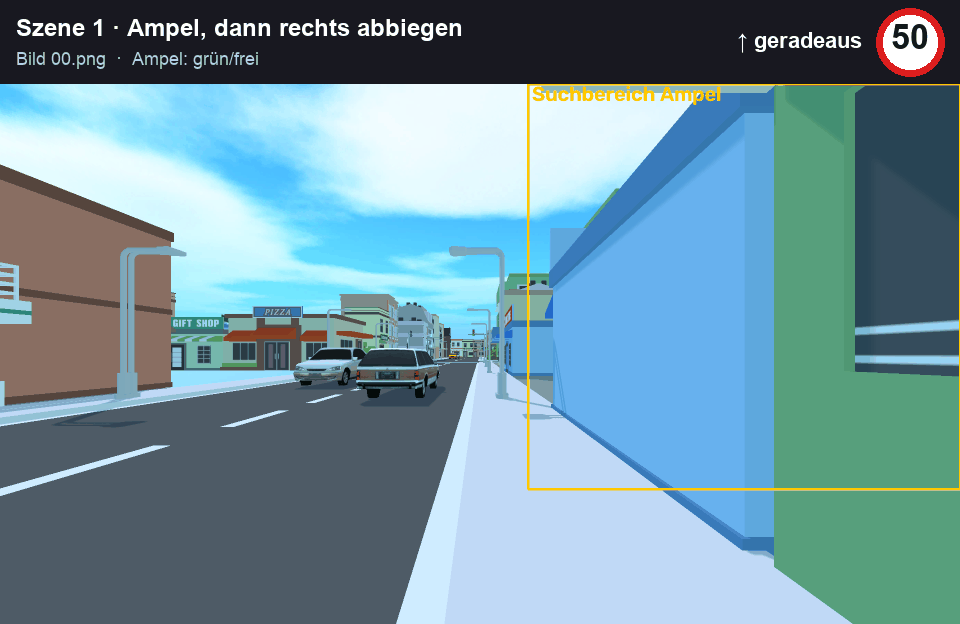
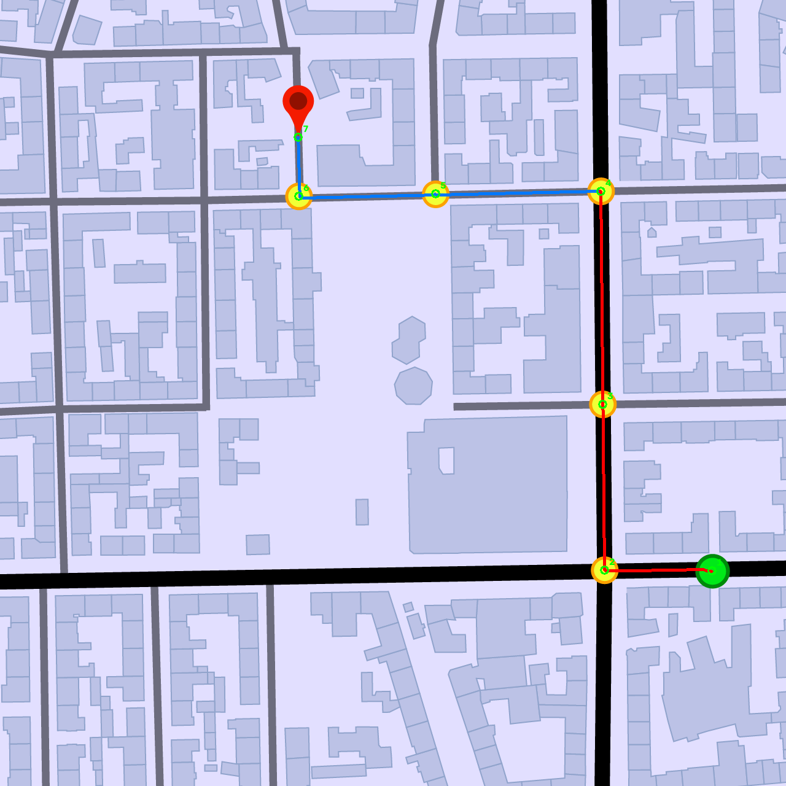
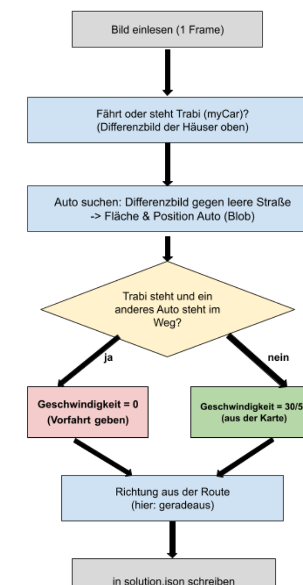
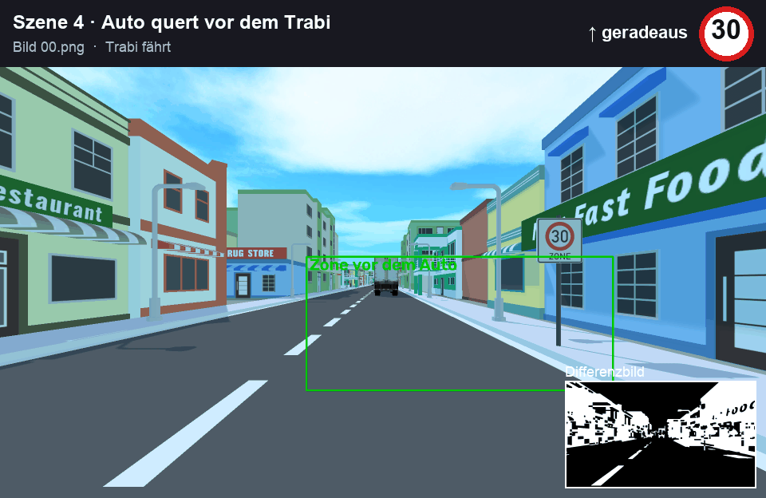

# Trabi: Verkehrssituationen mit klassischer Bildverarbeitung lösen

Dieses Abschlussprojekt aus dem Wahlpflichtfach **Digitale Bildverarbeitung** an der **Hochschule RheinMain** entstand im Sommersemester 2026 als Einzelarbeit. Die Aufgabe war, mithilfe der in der Vorlesung gezeigten Methoden ein selbstfahrendes Auto (den „Trabi“) unter Beachtung der Verkehrsregeln durch eine Stadt fahren zu lassen.

Statt eines neuronalen Netzes wie YOLO habe ich klassische Bildverarbeitung mit **Python und OpenCV** eingesetzt: Differenzbilder, Farbsegmentierung, Morphologie und Blob-Erkennung.



*Oben rechts: die Entscheidung des Programms (Geschwindigkeit und Richtung). Im Bild: Suchbereiche, erkannte Fahrzeuge (rot) und das Differenzbild.*

---

## Aufgabe

- Aus einer **Stadtkarte** werden vorab die **Route** und die erlaubte Geschwindigkeit (**30 oder 50**) bestimmt.
- In fünf Szenen muss für **jedes Bild** eine Geschwindigkeit und eine Richtung ausgegeben werden.
- Das Ergebnis landet in der `solution.json`.

### Route auf der Karte



Start (grün) und Ziel (rot) werden über ihre Farbe gefunden, die gelben Wegpunkte der Reihe nach verbunden. Die Straßen werden auf ihre Mittellinie ausgedünnt (Skelettierung), darauf sucht eine Breitensuche den Weg. Die Straßenbreite entscheidet über 30 oder 50.

---

## Ablauf pro Bild



Beispiel Szene 4: Der Trabi steht und ein anderes Auto fährt vor ihm über die Kreuzung → **Geschwindigkeit 0**. Sobald die Straße frei ist, fährt er mit 30 weiter.



 [Projektplakat mit allen Details als PDF](docs/Flussdiagramm.pdf)

---

## Verwendete Methoden

| Methode | Wofür |
|---------|-------|
| **Differenzbild** | zwei Bilder voneinander abziehen, damit sichtbar wird, was sich bewegt hat |
| **Hintergrundbild (Median)** | aus mehreren Standbildern die leere Straße berechnen |
| **Schwellwert und Morphologie** | aus dem Unterschied ein sauberes Bild vom Auto machen |
| **Connected Components** | Größe und Position eines Fahrzeugs messen |
| **HSV-Farbsegmentierung und Formprüfung** | Ampel, Vorfahrtsschild (gelbe Raute) und Punkte auf der Karte erkennen |
| **Distanztransformation und Skelettierung** | Straßenbreite messen (30/50) und die Route auf dem Straßennetz finden |

---

## Ergebnisse

Alle fünf Szenen sind gelöst:

| Szene | Situation | Geschwindigkeit pro Bild |
|-------|-----------|--------------------------|
| 1 | Ampel, dann rechts abbiegen | 50,50,50,50,0,0,0,0,0,0,10,10 |
| 2 | Vorfahrtstraße, durchfahren | 50,50,50,50,50,50,50 |
| 3 | LKW quert, dann links abbiegen | 50,50,50,0,0,0,10,10,10 |
| 4 | Auto quert vorne | 30,30,30,0,0,0,30,30,30 |
| 5 | Rechts vor Links | 30,30,30,0,0,0,30 |

---

## Herausforderungen und Lösungsansätze

- **Helle Autos auf heller Straße** waren schwer zu erkennen, Kantenerkennung (Canny) hat wegen Fahrbahnmarkierungen und Fassaden nicht funktioniert. Lösung: **Differenzbild** gegen die leere Straße.
- **Gegenverkehr** soll nicht zum Anhalten führen. Lösung: Nur Fahrzeuge **rechts der Mittellinie** zählen.
- Das **Vorfahrtsschild** war per Template Matching nicht zuverlässig zu finden (wegen Perspektive und Größe). Lösung: Erkennung über **Farbe (gelb) und Form (Raute mit vier Ecken)**.

## Grenzen

- Der Detektor für dunkle Fahrzeuge (Szene 3) erkennt keine hellen Autos. Dafür gibt es in Szene 4 und 5 das Differenzbild.
- Das Differenzbild funktioniert nur, wenn der Trabi steht. Während der Fahrt gilt die Geschwindigkeit aus der Karte.
- Die Grenze zwischen 30 und 50 hängt an einem festen Wert für die Straßenbreite. An Kreuzungen kann dieser Wert schwanken.

---

## Projekt starten

```bash
python3 -m venv venv
source venv/bin/activate          # Windows: venv\Scripts\activate
python3 -m pip install -r requirements.txt
python3 main.py
```

Das Programm berechnet die Route (`route_visualisierung.png`) und schreibt die Entscheidungen in `solution.json`.

### Demo-GIFs erzeugen

```bash
python3 tools/render_gifs.py
```

Das Skript wendet die Detektoren aus `main.py` auf jedes Bild an, blendet Erkennung und Entscheidung ein und speichert die GIFs im Ordner `docs/`. Es dient nur der Visualisierung, die Erkennungslogik steckt komplett in `main.py`.

---

> **Hinweis:** Die Szenenbilder und die Stadtkarte wurden im Rahmen der Lehrveranstaltung bereitgestellt und sind deshalb nicht in diesem Repository enthalten. Zum Ausführen müssen sie im Ordner `images/` liegen (`Scene_1` … `Scene_5`, `citymap`, `templates`).